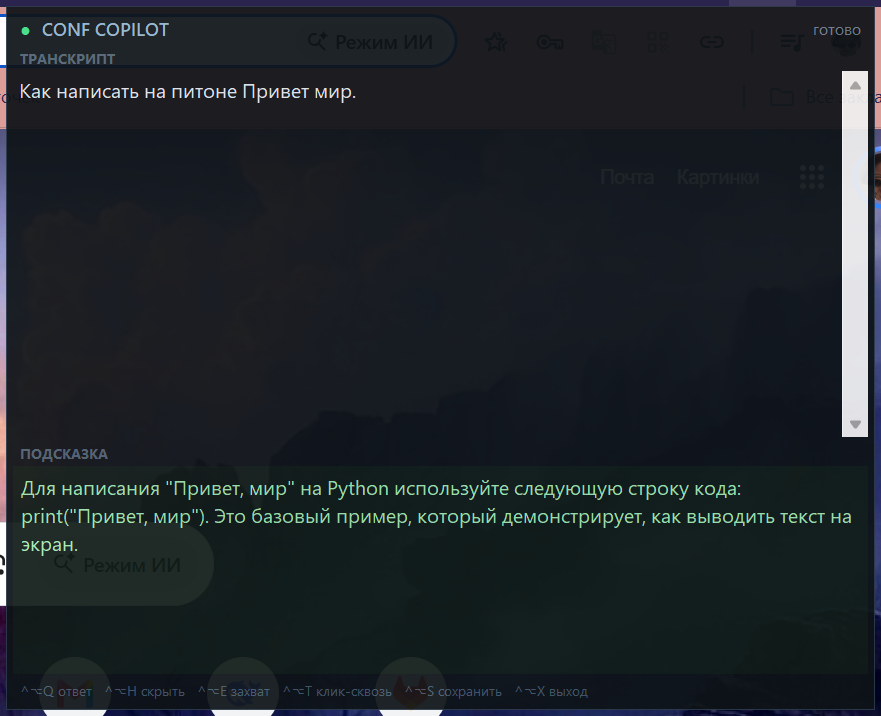

# Conference Copilot

Живые субтитры + подсказки для ответов на вопросы — оверлей поверх всех окон.
Слушает **системный звук** (то, что играет в наушниках/колонках), поэтому работает
с Zoom / Teams / Meet / YouTube / любым плеером: бот в звонок не заходит.



## Что умеет

- распознаёт речь **локально** (`faster-whisper`, CPU) — аудио никуда не уходит;
- сам определяет вопрос в речи и предлагает готовый ответ через OpenRouter;
- оверлей всегда сверху, таскается мышью, не попадает в шаринг экрана
  (presenter-notes mode, `Ctrl+Alt+E`);
- транскрипт сохраняется в `notes/` по `Ctrl+Alt+S` и при выходе.

## Установка с GitHub

```bat
git clone git@github.com:pti4kaExe/conference-copilot.git
cd conference-copilot
pip install -r requirements.txt
copy config.example.json config.json
```

Затем вписать ключ OpenRouter в `config.json` и запустить `run.bat`.

`config.json` в `.gitignore` — он локальный, с ключом. Ключ можно также держать
в переменной окружения `OPENROUTER_API_KEY`.

## Быстрый старт (3 шага)

1. `pip install -r requirements.txt`
2. Скопировать `config.example.json` → `config.json`, вписать `openrouter_api_key`
   (ключ с https://openrouter.ai/keys). При первом запуске файл создастся сам.
3. Двойной клик по `run.bat`

Первый запуск скачает модель распознавания (`base` ≈ 150 МБ) — это один раз.

> **Про производительность:** на i5-12450H модель `base` даёт ~0.9 с на 4.5-секундную
> фразу (5× реального времени), а `small` — ~6 с, то есть не тянет живой поток.
> Поэтому по умолчанию `base` и `cpu_threads: 4`: лишние потоки уходят на E-ядра
> и всё замедляют. Меняй только если уверен в своём CPU.

## Горячие клавиши (работают из любого приложения)

| Клавиши | Действие |
|---|---|
| `Ctrl+Alt+Q` | попросить ответ прямо сейчас (без ожидания вопроса) |
| `Ctrl+Alt+C` | скопировать транскрипт и подсказку в буфер обмена |
| `Ctrl+Alt+H` | скрыть / показать оверлей |
| `Ctrl+Alt+E` | вкл/выкл невидимость в шаринге экрана (presenter-notes mode) |
| `Ctrl+Alt+T` | клик-сквозь: мышь проходит к окну под оверлеем |
| `Ctrl+Alt+S` | сохранить транскрипт в `notes/` |
| `Ctrl+Alt+X` | выход (транскрипт сохраняется автоматически) |

Окно можно таскать мышью за шапку; позиция и размер запоминаются.

## Как копировать текст

Оверлей — окно без рамки, и обычный `Ctrl+C` в нём раньше не срабатывал: disabled-виджет
не получал фокус клавиатуры. Теперь копирование работает тремя способами:

1. **Выделить мышью** — текст сразу уходит в буфер (тянуть от начала до конца фразы).
2. **`Ctrl+Alt+C`** — копирует весь транскрипт и текущую подсказку, работает из любого окна.
3. **Правый клик** по панели — «Копировать всё из панели» / «Копировать транскрипт и
   подсказку» / «Очистить панель». Там же обычный `Ctrl+C` по выделению.

Буфер кладётся через Win32, поэтому текст остаётся в буфере даже после закрытия приложения.

## Настройки (`config.json`)

| Поле | Смысл |
|---|---|
| `openrouter_api_key` | ключ OpenRouter (или переменная окружения `OPENROUTER_API_KEY`) |
| `answer_model` | модель для подсказок, по умолчанию `openai/gpt-4o-mini` (дёшево и быстро) |
| `whisper_model` | `tiny` / `base` / `small` / `medium` — точность против скорости |
| `language` | `ru`, `en` или `""` для автоопределения |
| `cpu_threads` | потоков CPU для распознавания |
| `hide_from_capture` | оверлей не попадает в шаринг экрана и скриншоты |
| `auto_answers` | отвечать автоматически, когда в речи слышится вопрос |
| `answer_cooldown_sec` | пауза между автоматическими ответами, чтобы не спамить |

## Проверка без конференции

```bat
python copilot.py --list-devices      :: какие аудиоустройства видны
python copilot.py --selftest 10       :: 10 секунд слушает и печатает субтитры в консоль
```

Если в `--selftest` ничего не печатается — проверь, что в системе реально играет звук
(запусти любое видео) и что `--list-devices` показывает loopback-устройство.

## Как это устроено

```
системный звук (WASAPI loopback, soundcard)
   → VAD: нарезка на фразы 0.5–9 с по тишине
   → faster-whisper (локально, CPU int8) → строка транскрипта
   → эвристика «это вопрос?» (?, вопросительные слова)
   → OpenRouter → готовый ответ в панель «ПОДСКАЗКА»
```

`hide_from_capture` использует `SetWindowDisplayAffinity(WDA_EXCLUDEFROMCAPTURE)` —
тот же механизм, что у PowerPoint Presenter View: на мониторе видно, в шаринге нет.

## Если что-то не так

- **Нет субтитров.** Нет звука в системе / выбрано не то устройство вывода → `--list-devices`.
- **Медленно.** Поставь `whisper_model: "base"` или `"tiny"`; закрой лишние вкладки.
- **Ошибка OpenRouter 401.** Ключ неверный/закончился баланс.
- **Окно не появляется.** Оно могло спрятаться за другими окнами — `Ctrl+Alt+H`.
- **Не видно в Teams при шаринге — это норма**, так задумано (`Ctrl+Alt+E` переключает).
- **Два окна / второй экземпляр.** Запускать нужно один раз: при повторном старте
  приложение видит уже работающее окно, поднимает его наверх и выходит (код 2).
  Если осталось «потерянное» окно — `Ctrl+Alt+X` в нём или `taskkill /F /IM python.exe`.
- **Окно перекрывает контент.** Тащи за шапку, либо `Ctrl+Alt+T` (клик-сквозь),
  либо `Ctrl+Alt+H` (скрыть).

## Если git не подключается к GitHub

В некоторых сетях (корпоративные, часть провайдеров) закрыт порт 22, и `git clone`
по SSH падает с `Permission denied (publickey)` или `Connection timed out`.
Рабочая схема — SSH через 443 и системный OpenSSH вместо встроенного в Git for Windows:

```bat
git clone ssh://git@ssh.github.com:443/pti4kaExe/conference-copilot.git
cd conference-copilot
git config core.sshCommand "C:/Windows/System32/OpenSSH/ssh.exe -o BatchMode=yes"
```

Проверить доступ: `ssh -p 443 -T git@ssh.github.com` — должно ответить
`Hi <username>! You've successfully authenticated`.

